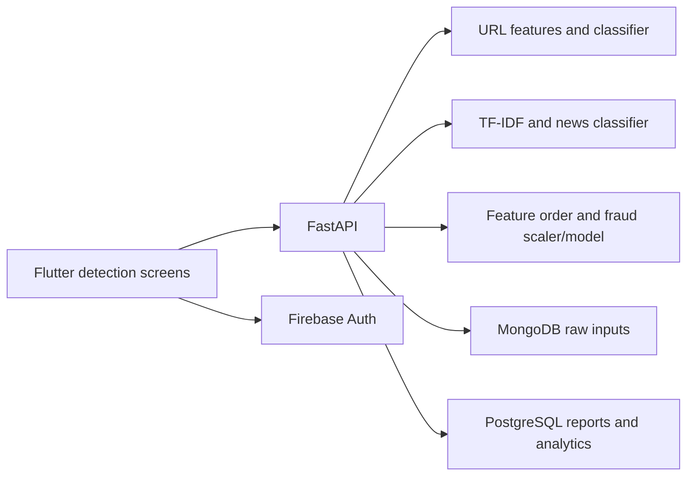

# SahiCheck

A Flutter and Python detection prototype that brings phishing URL classification, news-text classification, transaction fraud detection, and live news views into one application.

The project demonstrates separate feature pipelines behind a shared API, Firebase account flows, and persistence of raw inputs and structured prediction reports.

## Stack

| Layer | Technologies |
| --- | --- |
| App | Flutter, Dart `^3.10.8`, Firebase Authentication, HTTP |
| API | Python, FastAPI, Pydantic, Uvicorn |
| Models | scikit-learn, pickle artifacts, TF-IDF, NumPy/pandas |
| Storage | MongoDB through PyMongo; PostgreSQL through psycopg2 |
| News | Feed/source processing modules under `sahicheck_backend/` |

See [backend requirements](sahicheck_backend/requirements.txt) and [Flutter dependencies](sahicheck_frontend/pubspec.yaml) for exact declarations.

## Architecture



Models load from `saved_models/` on startup. Database connections are lazy and storage can be skipped when unavailable; a successful prediction alone does not confirm that both databases persisted data. Some URL features are computed from the URL while HTML/reputation-related features are currently filled with defaults.

## Local setup

```sh
git clone https://github.com/Abdul-Hadi-Jalil/SahiCheck.git
cd SahiCheck
python -m venv sahicheck_backend/.venv
```

Activate that environment and install dependencies:

```sh
python -m pip install -r sahicheck_backend/requirements.txt
cd sahicheck_backend
python -m uvicorn main:app --reload --host 0.0.0.0 --port 8002
```

Run from `sahicheck_backend/` because model paths are relative to the working directory. Use a Python interpreter supported by the pinned dependencies and compatible with the serialized estimators; installation and artifact compatibility must be verified together.

### Storage configuration

Set process environment variables before starting Uvicorn:

| Variable | Purpose |
| --- | --- |
| `MONGO_URI` | MongoDB connection |
| `POSTGRES_HOST` | PostgreSQL host |
| `POSTGRES_DB` | Database name |
| `POSTGRES_USER` | Database user |
| `POSTGRES_PASSWORD` | Your local database password |

The main module reads `os.getenv`; do not assume a `.env` file is automatically loaded. Use your own database credentials and do not rely on source defaults. Inspect [POSTGRESQL_SETUP.sql](POSTGRESQL_SETUP.sql) and [database schemas](DATABASE_SCHEMAS.md) before applying them to a dedicated development database. The API selects `sahicheck_schema, public`.

### Flutter client

Configure your Firebase project and authentication, then update `AppConfig.baseUrl` in `sahicheck_frontend/lib/services/config.dart`. Use `http://10.0.2.2:8002` for an Android emulator or your backend's reachable address.

```sh
cd sahicheck_frontend
flutter pub get
flutter devices
flutter run -d <device-id>
```

## API

Open `http://127.0.0.1:8002/docs` for current schemas.

| Endpoint | Input |
| --- | --- |
| `POST /phishing` | `url`, `user_id` |
| `POST /fake-news` | `title`, `text`, `user_id` |
| `POST /fraud` | `time`, `v1`–`v28`, `amount`, `user_id` |
| `GET /` | Service response |
| `GET /test-mongo` | MongoDB diagnostic |

The fraud endpoint expects engineered transaction features, not simply a merchant name and amount. A client-supplied `user_id` is not proof of authenticated API identity.

## Verification and project scope

Run `flutter analyze` and `flutter test` inside the frontend, then test each inference route and verify database writes separately with development inputs. Only deserialize trusted model files.

Model outputs are classification signals, not a guarantee that a URL is safe, an article is true, or a transaction is legitimate. Evaluation, calibration, server-side authentication, and deployment hardening need independent verification.

For more context, see the existing [architecture notes](ARCHITECTURE.md), [database schemas](DATABASE_SCHEMAS.md), and [mobile networking guide](MOBILE_SETUP_GUIDE.md). Where older guides describe planned behavior, the source files and current OpenAPI schema are the implementation reference.
